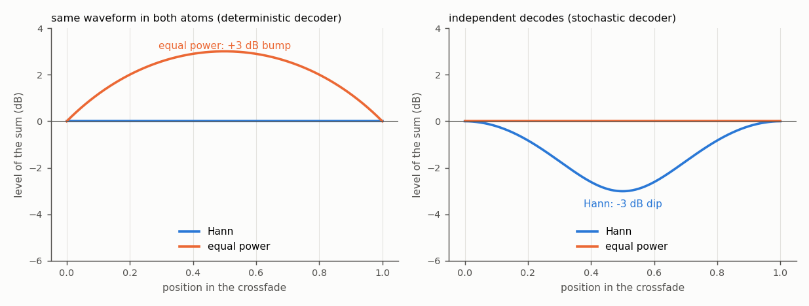
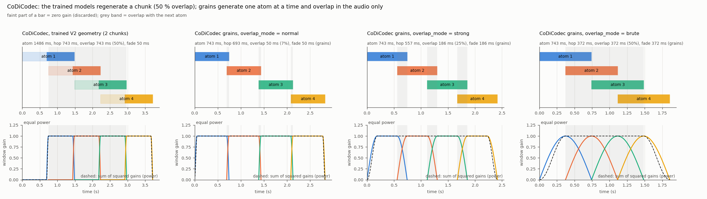
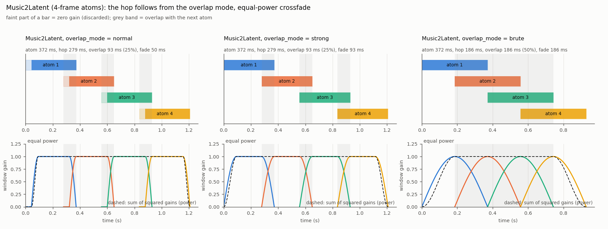

# Overlap-add of atoms

In atoms mode every generated atom is decoded on its own and the atoms are laid on one timeline, each one a hop after the
previous one, then multiplied by a window and summed. This page explains the geometry, the two crossfade laws and the overlap
modes of the stochastic decoders. The figures are drawn from the real geometry code (`scripts/make_overlap_diagrams.py`).

## Geometry

An atom has `F` latent frames, the hop is `H` frames, so consecutive atoms overlap by `O = F - H` frames. A frame is `h`
samples. The window of an atom (`ola_window` in `SCAPES/data/geometry.py`) is, in order:

| part | length (samples) | gain |
|---|---|---|
| leading zeros | `O*h - X` | 0 |
| rise | `X` | 0 to 1 |
| flat | `H*h - X` | 1 |
| fall | `X` | 1 to 0 |

`X` is the crossfade length, at most `min(H*h, O*h)`. The fall of one atom lands exactly on the rise of the next, so only the last
`H*h + X` samples of an atom reach the output: the new audio plus the crossfade into the previous atom. The start and the end of
the whole clip fade in and out, because there is nothing to cross into. A clip of `K` atoms has `((K-1)*H + F) * h` samples.

The overlap-add is always done on the decoded audio: the latents of each atom are decoded on their own and the audio is
windowed and summed. Latents are never added. What can overlap in the latent domain is the span of time two atoms cover
(shared frames, regenerated by the second atom).

The hop is also the rate at which the semantic conditioning (one CLAP vector per unit) changes.

## Two crossfade laws



- **Hann** (`hann`): rise + fall = 1. The amplitudes add up to 1. This is right when both atoms hold the same waveform in the
  overlap (a deterministic decoder, where the regenerated frames agree with the previous atom). With independent audio it dips
  by 3 dB in the middle of the fade.
- **Equal power** (`equal_power`): the square root of the Hann halves, rise^2 + fall^2 = 1. The powers add up to 1. This is right
  when the two atoms are independent decodes of similar latents (a stochastic decoder). With the same waveform in both atoms it
  would bump by 3 dB in the middle of the fade.

The law is chosen by codec (`crossfade_law_for`): equal power for CoDiCodec and Music2Latent, Hann for EnCodec 48k. The
config key `atoms.crossfade_law = "hann" | "equal_power"` overrides it. `ola_window(geom)` without a law is Hann, which is what
the V1 tests check.

## EnCodec 48k (deterministic decoder)


0.32 s atoms, 0.1 s hop, 0.02 s fade. The overlap is long (220 ms) on purpose: the model regenerates the end of the previous
atom, so that the two decodes agree there and the audio is continuous (the design intent of V1). Only the last 0.12 s of each atom is used. `normal` crossfades
are all this codec needs; the overlap modes below are not available for it (`atoms.hop_seconds` and `atoms.crossfade_seconds`
set the geometry).

## Stochastic decoders: CoDiCodec and Music2Latent

The same latents decode to different waveforms each time (the decoder starts from noise). Regenerating past frames therefore
does not make the audio continuous, and the atoms only overlap to be crossfaded. `atoms.overlap_mode` sets how much, as a
fraction of the atom, and the hop follows from it. Other codecs reject `atoms.overlap_mode`.

| `atoms.overlap_mode` | overlap | crossfade |
|---|---|---|
| `normal` | one quantum (Music2Latent) or 50 ms (grains) | short fade, `atoms.crossfade_seconds` (default 0.05 s) |
| `strong` | 25 % of the atom | the whole overlap |
| `brute` | 50 % of the atom | the whole overlap |

`atoms.hop_seconds` must not be set; `atoms.crossfade_seconds` is only used by `normal`. The mode is part of the geometry a
model is trained with: it is chosen in the config before dataprep and training and is stored in `inference.gin`.

There are two ways to overlap, one per codec.

### CoDiCodec: grains (one atom at a time)



CoDiCodec works in whole chunks of 0.743 s (quantum 8 frames), too coarse to overlap by sharing frames. The model generates one
atom at a time (template `SCAPES/config/codecs/codicodec_grains.gin`: 1 chunk, 0.743 s). Consecutive atoms share no latent
frames (hop = atom in frames; training windows and the CLAP grid do not overlap either). The decoded atoms are placed in the
audio with the overlap, so the output is shorter than the atoms laid end to end, and the audio hop is the conditioning rate:

| mode | overlap | audio hop (conditioning rate) |
|---|---|---|
| `normal` | 50 ms | 0.693 s (1.4 Hz) |
| `strong` (template default) | 25 % = 0.186 s | 0.557 s (1.8 Hz) |
| `brute` | 50 % = 0.372 s | 0.372 s (2.7 Hz) |

The first panel of the figure is the geometry of the models trained so far (`codicodec_atoms.gin`: 2-chunk atoms, 1-chunk hop,
which regenerates a chunk). It is unchanged and those models still work; they are now rendered with equal power. With atoms of
2 chunks (`atoms.seconds = 1.48`) a grain is 1.49 s long and the overlaps double.

### Music2Latent: shared latent frames (frame 4096 samples = 93 ms, quantum 1)



A frame is short enough to overlap by sharing frames: the next atom regenerates `O` frames of the previous one and the audio
is crossfaded over them. Template `SCAPES/config/codecs/music2latent_atoms.gin`: 4-frame atoms (0.37 s). The overlap is a
fraction of the atom rounded to frames (at least one, at most the hop).

| mode | atom | overlap | hop (conditioning rate) | fade |
|---|---|---|---|---|
| `normal` | 4 frames, 372 ms | 1 frame, 93 ms (25 %) | 3 frames, 279 ms (3.6 Hz) | 50 ms |
| `strong` (template default) | 4 frames | 1 frame, 93 ms (25 %) | 3 frames, 279 ms (3.6 Hz) | 93 ms |
| `brute` | 4 frames | 2 frames, 186 ms (50 %) | 2 frames, 186 ms (5.4 Hz) | 186 ms |

With 8-frame atoms (0.74 s) the three modes give hops of 7, 6 and 4 frames (650, 557 and 372 ms). A conditioning rate of 0.1 s
needs a hop of one frame, which means 2-frame atoms; then every mode has the same 1-frame overlap and the modes only differ in
the fade length.

## Config summary

```
codec.name = "music2latent"
generation.mode = "atoms"
atoms.seconds = 0.37            # atom, rounded up to whole quanta
atoms.overlap_mode = "strong"   # normal | strong | brute (stochastic decoders only); sets the hop
# atoms.crossfade_seconds       # only for "normal"
# atoms.crossfade_law = "equal_power"   # hann | equal_power; default by codec
```

Limitation: the teacher-forced evaluation (`scripts/teacher_forced_eval.py`) compares with the original audio, so for grains
(whose output is shorter than the source) it needs the plain concatenation of the atoms; it is not adapted yet.

Not changed: the crossfade that `audio_extender` (`SCAPES/auxiliar/clap_wrapper.py`) applies when it repeats a short clip
for CLAP. It is linear and part of the conditioning, which the V1 reference tests fix.

Regenerate the figures: `python scripts/make_overlap_diagrams.py`.
