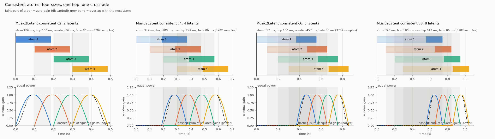
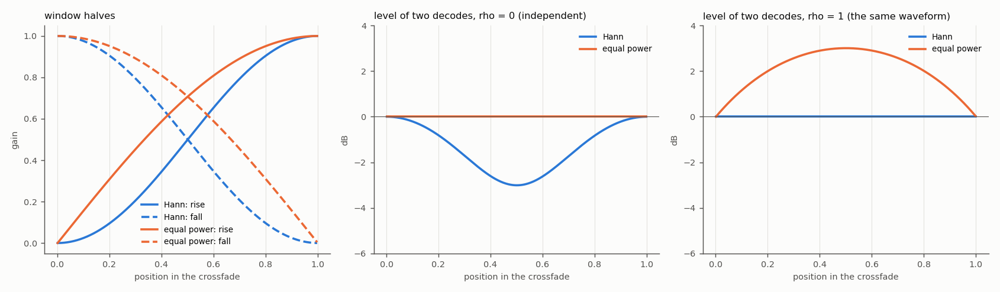
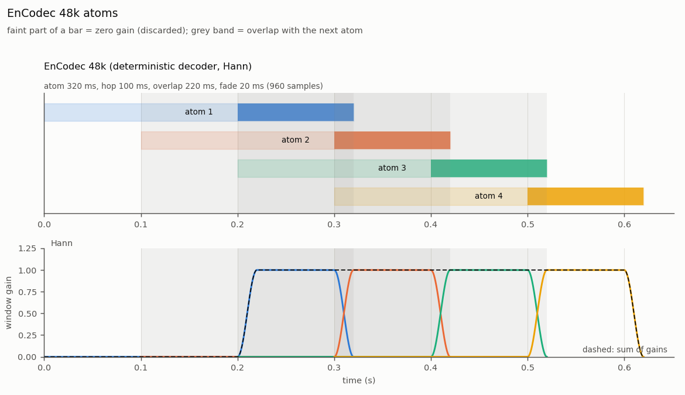

# Overlap-add of atoms

In atoms mode every generated atom is decoded on its own, the atoms are laid on one timeline a hop apart, multiplied by a
window and summed. This page gives the window layout, the consistent atom type, the no-time-loss Lemma, the two windows, the
geometry table and the config keys. The figures are drawn from the real geometry code (`scripts/make_overlap_diagrams.py`).

## Window layout

An atom has `C` samples (the chunk), consecutive atoms start `H` samples apart (the hop), and the crossfade has `X` samples.
The window of an atom (`ola_window` in `SCAPES/data/geometry.py`) is, in order:

| part | length (samples) | gain |
|---|---|---|
| leading zeros | `C - H - X` | 0 |
| rise | `X` | 0 to 1 |
| flat | `H - X` | 1 |
| fall | `X` | 1 to 0 |

The fall of one atom lands exactly on the rise of the next, so only the last `H + X` samples of an atom reach the output.
A clip of `K` atoms has `(K - 1) * H + C` samples, with `K = 1 + (N - C) // H` for a source of `N` samples. The valid region
(where a clip is the source, if the codec were exact) is `[C - H, (K - 1) * H + C - X)`; the start and the end fade in and out.
The overlap-add is always done on the decoded audio; latents are never added.

## Consistent atoms



The consistent type (`atoms.type = "consistent"`) has the hop at exactly 0.1 s (`H = 4410` samples at 44.1 kHz, off the 4096
grid of the codec) and a chunk of `F` latents, `C = 4096 F`. Every segment `x[kH : kH + C]` is encoded on its own, so each atom
is a codec output for its own audio. The crossfade is the same for the four sizes: `X = 3782` samples (85.8 ms), the whole
overlap of the 2-latent atom (`C - H = 3782`), so that the sizes compare fairly. The rest of the overlap is zeroed.
`atoms.crossfade_seconds = 0.08574` because the loader rounds the seconds up to samples.

**Lemma (no time loss).** If the decoder inverts the encoder and the window is Hann, the overlap-add equals the source on the
valid region: where an atom has a non-zero gain it holds the same samples as the source, the Hann halves sum to 1 at every
join, and joins do not overlap each other because `H >= X`. The test `test_identity_reconstruction_no_time_loss` checks it with
a toy codec; `scripts/atoms_check.py` reports the envelope lag of a real round trip, with a delayed and a shortened-hop control (non-gating).

| variant | latents F | C | H | X | zeroed | rate (Hz) | memory time, M = 3 (s) |
|---|---|---|---|---|---|---|---|
| `m2l-cons-c2` | 2 | 8192 | 4410 | 3782 | 0 | 10.00 | 0.39 |
| `m2l-cons-c4` (template) | 4 | 16384 | 4410 | 3782 | 8192 | 10.00 | 0.57 |
| `m2l-cons-c6` | 6 | 24576 | 4410 | 3782 | 16384 | 10.00 | 0.76 |
| `m2l-cons-c8` | 8 | 32768 | 4410 | 3782 | 24576 | 10.00 | 0.94 |
| `m2l-ind-c{2,4,6}-{normal,strong,brute}` | 2 / 4 / 6 | 8192 / 16384 / 24576 | C - X | C / 8, C / 4, C / 2 | 0 | | not implemented yet |
| `cdc-ind-c8-{normal,strong,brute}` | 8 | 32768 | C - X | C / 8, C / 4, C / 2 | 0 | | not implemented yet |

Memory time is `C + (M - 1) H`. The representation key is `<codec>__atoms-c{C}-h{H}`.

## Two windows



- **Hann** (`hann`): rise + fall = 1, so amplitudes add to 1. Right when both atoms hold the same waveform in the overlap
  (coherent audio). With independent audio the level dips by 3 dB at the middle of the crossfade.
- **Equal power** (`equal_power`): the square roots of the Hann halves, rise^2 + fall^2 = 1, so powers add to 1. Right when the
  two decodes are independent (incoherent). With the same waveform in both it would bump by 3 dB at the middle.

For two decodes with correlation `rho`, the power at a point of the crossfade is `a^2 + b^2 + 2 rho a b`; the two windows
give the same level at the centre when `rho = sqrt(2) - 1 = 0.41`. The measured `rho` of two Music2Latent decodes
(`rho_pair` at a 882-sample crossfade, `runs/window_check`) is about 0.13 on average, per file up to 0.67, with `rho_seed` 0.27-0.31; this is far below it on average, and Esteban chose `equal_power` (gate W, 2026-10-30).

The window is not part of what a model learns: the atoms are the same latents under either window, so it is chosen at render
time and can be changed after training without retraining (`atoms.window` in the config, written to `inference.gin`).
EnCodec 48k keeps Hann: its decoder is deterministic, so two decodes of the same moment are coherent and amplitudes add
(`ola_window` comment, to be checked in the window study of the independent-atoms work (A1)).



## Config keys

```
codec.name = "music2latent"
generation.mode = "atoms"
atoms.type = "consistent"        # consistent | independent (independent: not implemented yet)
atoms.seconds = 0.37             # chunk C, rounded up to whole latents (0.18 / 0.37 / 0.55 / 0.74 -> 2 / 4 / 6 / 8)
atoms.hop_seconds = 0.10         # hop H (4410 samples)
atoms.crossfade_seconds = 0.08574   # X (3782 samples), at most min(H, C - H)
atoms.window = "equal_power"     # hann | equal_power
# atoms.overlap = "strong"       # independent atoms only (not implemented yet): normal | strong | brute; sets H and X
```

The keys of the removed overlap modes and crossfade laws are rejected by the config loader with a message naming `atoms.type` and `atoms.window`. Config
templates are `SCAPES/config/codecs/music2latent_consistent.gin` (the c4 default; c2, c6 and c8 change `atoms.seconds` only,
see `scripts/make_atoms_configs.py`) and `encodec48k_atoms.gin`, `codicodec_atoms.gin` (legacy frame atoms, unchanged).

Not changed: the crossfade that `audio_extender` (`SCAPES/auxiliar/clap_wrapper.py`) applies when it repeats a short clip for
CLAP. It is linear and part of the conditioning, which the V1 reference tests fix.

Regenerate the figures: `python scripts/make_overlap_diagrams.py`.
